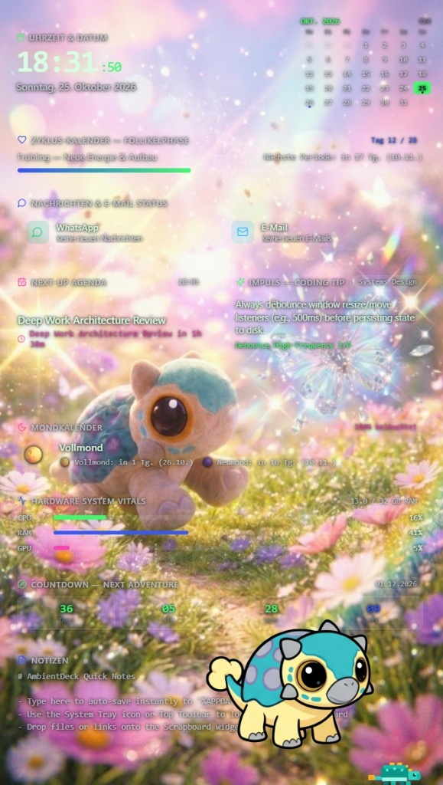

<div align="center">


# 🦖 Dino-ambient-desk

**Elegantes Ambient Desktop-Dashboard & Widget für Windows 10/11**  
*Rahmenloses Glassmorphism-Design mit transparenten Schwebekarten, lebendig animiertem Ankylosaurus-Begleiter, bearbeitbaren Kalendernotizen und Frauen-Zyklus-Tracker.*

[](https://github.com/x4rinia/Dino-ambient-desk/releases)
[](https://dotnet.microsoft.com/)
[](https://react.dev/)
[](https://www.typescriptlang.org/)
[](https://microsoft.com/windows)

---

### 📸 Beispiel-Vorschau (Live Ambient Dashboard)



*Zentrierte Überschrift mit dezentem `by x4rinia`, schwebende Glas-Widgets und lebendiger Ankylosaurus-Begleiter auf dem echten Windows-Desktop-Wallpaper.*

</div>

---

## ✨ Features & Highlights

1. **Echtes Windows-Hintergrundbild mit 3 Widget-Stilen:**
   - Zwischen den Widgets wird immer das echte, gestochen scharfe Windows-Desktop-Hintergrundbild angezeigt.
   - **🪟 Glas-Effekt:** Edle Milchglas-Karten mit sanfter Lichtbrechung.
   - **🌫️ Geblurrt:** Nur der Bereich hinter den einzelnen Widgets wird weichgezeichnet.
   - **⬛ Schwarz:** Tiefschwarze minimalistische Panels.

2. **🦕 Lebendiger Ankylosaurus-Begleiter (Transparent freigestellt):**
   - **🐾 Laufen von links nach rechts:** Wandert ruhig und gleichmäßig über die konfigurierbare Laufbereich-Breite (ohne ständiges hektisches Hin- und Herdrehen).
   - **🦘 Springen & Freuen:** Geht ab und zu in die Knie, springt fröhlich hoch in die Luft, jubelt mit offenen Armen und landet sanft wieder.
   - **👀 Nach vorn schauen:** Wendet den Kopf zur Kamera und schaut dich mit großen, neugierigen Augen an.
   - **✨ Mit der Keule wedeln:** Bleibt stehen und wedelt mit seiner Schwanzkeule inklusive Bewegungs- und Glitzereffekt.
   - **🏃 Schnelligkeit & ✨ Transparenz:** Tempo (50% bis 160%) und Deckkraft (20% bis 100%) frei über Schieberegler einstellbar.
   - **⚓ Sichtbarer Laufbereich beim Einstellen:** Bei geöffneten Einstellungen zeigt ein grün gestrichelter Rahmen genau die linke und rechte Grenze. Nach dem Speichern wird der Rahmen **vollständig unsichtbar**.

3. **🏷️ Zentrierte Überschrift & dezentes Branding:**
   - Text frei wählbar (z. B. `🦖 X4rinia und Dino <3`), zentriert ausgerichtet mit dezentem `by x4rinia` in der rechten Ecke.

4. **Frei verschiebbare Widgets (Verschiebe-Modus):**
   - Jedes Widget (Überschrift, Uhr & Kalender, Zyklus-Tracker, Hardware-Vitals, Countdown, Dino-Laufbereich) lässt sich bei geöffnetem Einstellungsfenster frei mit der Maus an jede Wunschposition verschieben.
   - Positionen bleiben nach dem Speichern pixelgenau an Ort und Stelle.
   - Bleibt im normalen Modus 100% klick-transparent wie ein echtes Hintergrundbild.

5. **📅 Bearbeitbare Kalendernotizen (max. 3 aktiv):**
   - Direkt in den Einstellungen editierbar (Titel & Datum/Uhrzeit).
   - Abgelaufene Termine werden automatisch gelöscht.
   - Optionaler Import externer Kalender über **Google Kalender / iCal URL (`.ics`)**.

6. **🌸 Zyklus-Kalender (Frauen-Zyklus):**
   - Übersichtliche Anzeige der aktuellen Zyklusphase, Zyklustag, Periodenstatus und Countdown zum nächsten Zyklus inklusive grafischer Verlaufsleiste (ohne Jahreszeiten-Metaphern).

7. **⚡ System-Tray & Einstellungen:**
   - Läuft diskret im Windows-Infobereich (System-Tray) mit Rechtsklick-Menü (`Einstellungen` und `Beenden`).
   - Taskleisten-Eintrag für das Hintergrund-Widget ist ausgeblendet.

---

## 🚀 Download & Schnellstart

1. Lade dir die fertige **[Dino_ambient_Deck.zip](https://github.com/x4rinia/Dino-ambient-desk/releases)** herunter und entpacke sie.
2. Starte die `Dino_ambient_Deck.exe`.
3. Klicke im Infobereich (unten rechts neben der Windows-Uhr) auf das Dino-Symbol, um die Einstellungen zu öffnen.

---

## 🛠️ Entwicklung & Build

### Voraussetzungen
* Windows 10/11
* [.NET 10 SDK](https://dotnet.microsoft.com/)
* [Node.js 18+](https://nodejs.org/)

### Repository klonen
```powershell
git clone https://github.com/x4rinia/Dino-ambient-desk.git
cd Dino-ambient-desk
```

### Frontend bauen
```powershell
npm --prefix frontend install
npm --prefix frontend run build
```

### Single-File .exe erstellen
```powershell
dotnet publish -c Release -r win-x64 --self-contained false -p:PublishSingleFile=true -o ".\bin\PublishSingleFile"
```

---

<div align="center">
  <sub>Erstellt mit ❤️ by x4rinia</sub>
</div>
