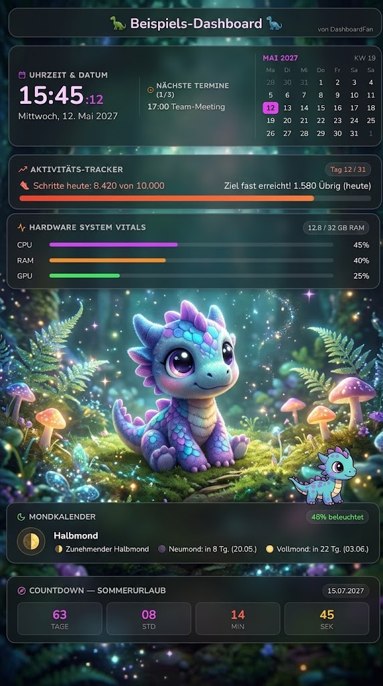

<div align="center">

<p float="center">
  
  &nbsp;&nbsp;&nbsp;&nbsp;
  
</p>

# Dino-ambient-desk

**Ambient Desktop-Dashboard und Widget fuer Windows 10 und 11**  
*Rahmenloses Glassmorphism-Design mit transparenten Schwebekarten, animiertem Ankylosaurus-Begleiter, Kalender-Notizen, System-Monitoring und flexibler Modulanordnung.*

[](https://github.com/x4rinia/Dino-ambient-desk/releases)
[](https://dotnet.microsoft.com/)
[](https://react.dev/)
[](https://www.typescriptlang.org/)
[](https://microsoft.com/windows)

</div>

---

## Uebersicht

Dino-ambient-desk ist ein leichtgewichtiges, aushilfsfreies Desktop-Dashboard fuer Windows 10 und 11. Es integriert sich nahtlos in den Desktop-Hintergrund, laeuft ressourcenschonend im Hintergrund und bietet sowohl praktische Widgets fuer den Alltag als auch anpassbare Begleiter-Animationen.

In der Beispielansicht oben sind die verfuegbaren Widgets uebersichtlich angeordnet:
* **Uhrzeit & Datum:** Grosse Zeitanzeige, Wochentag, Kalender mit ISO-8601 Kalenderwoche (KW) und naechste Termine
* **Aktivitaets-Tracker:** Fortschrittsanzeige fuer Tagesziele (z. B. Schrittzaehler)
* **Hardware System Vitals:** Echtzeit-Balken fuer CPU, RAM und GPU
* **Desktop-Begleiter:** Frei waehlbarer Begleiter (wie der abgebildete Drache oder Dino), der ueber die Plattform laeuft
* **Mondkalender:** Aktuelle Mondphase mit Beleuchtungsgrad und Tagen bis zum naechsten Vollmond/Neumond
* **Event-Countdown:** Sekundenaktuelle Restzeit bis zum gewuenschten Zieldatum (z. B. Urlaub)

---

## Alle Funktionen im Detail

### 1. Animierte Schreibtisch-Begleiter & Addon-System
* **Begleiter-Auswahl per Knopfdruck:** Ueber einen eigenen Button in den Einstellungen koennen alle erkannten Begleiter uebersichtlich in einer Galerie angezeigt und per Klick aktiviert werden.
* **Standard-Begleiter (Dino Desk Team):** Standardmaessig ist der niedliche Drache als treuer Schreibtisch-Begleiter aktiv. Zusaetzlich ist der klassische Ankylosaurus-Dino vorinstalliert.
* **Kompaktes Addon-Dateiformat (.companion.json):** Jeder Begleiter ist in einer einzigen, eigenstaendigen Datei gebuendelt (Name, Beschreibung, Vorschaubild und alle Animations-Frames). Es muessen keine tausenden Einzel-Dateien oder Ordner mehr verwaltet werden.
* **Ordner-Zugriff & Live-Erkennung:** Neue Begleiter lassen sich einfach als .companion.json herunterladen und ueber den Button "Ordner oeffnen" in das Begleiter-Verzeichnis ablegen. Das Dashboard erkennt neu hinzugefuegte Begleiter automatisch in Echtzeit.
* **Zusatz-Paket (addon.zip):** 10 weitere Begleiter (Biene, Diddl, Elfe, Mops, Terrier, 2 Katzen, Optimus, Roboter, Waldtroll) stehen als separates Addon-Archiv (addon.zip) zur Verfuegung.
* **Fokussierte Animationen:** Alle Begleiter verfuegen ueber eine gleichmaessige, natuerliche 4-Frame-Laufanimation. Der Ankylosaurus besitzt darueber hinaus zusaetzlich Keulen-Wedeln und einen Freudensprung.
* **Individuell ein- und ausschaltbare Animationen:** Das Laufen kann in den Einstellungen ueber ein Kontrollkaestchen flexibel aktiviert oder deaktiviert werden. Fuer den Ankylosaurus lassen sich Keulen-Wedeln und Freudensprung zusaetzlich separat steuern.
* **Ruhemodus / Auf der Stelle stehen:** Wird das Laufen deaktiviert, bleibt der Begleiter ruhig an seinem Ankerpunkt stehen. Sind alle Animationen deaktiviert, verharrt er friedlich im Standbild.
* **Stufenlose Skalierung (Begleiter-Groesse):** Ueber einen Schieberegler von 50% bis 160% in 5%-Schritten skalierbar. Durch die Verankerung an den Fuessen bleibt der Begleiter bei jeder Groesse exakt auf der Standlinie.
* **Geschwindigkeit, Transparenz und Laufbreite:** Tempo (50% bis 160%), Transparenz (20% bis 100%) und die Weite des Laufbereichs (300px bis 850px) sind frei einstellbar.
* **Visuelle Ausrichtungshilfe:** Bei geoeffneten Einstellungen wird der gesamte Laufbereich mit einem gruen gestrichelten Rahmen dargestellt und kann per Maus an jede Wunschposition auf dem Bildschirm gezogen werden. Nach dem Speichern wird der Rahmen vollstaendig unsichtbar.
* **Integrierter Begleiter-Editor (companion-editor):** Im Ordner companion-editor steht ein vollstaendiger visueller Sprite- und Begleiter-Editor bereit. Bis zu 8 Bilder koennen importiert, Hintergruende transparent freigestellt, die Groesse skaliert und die fertige .companion.json Datei mit einem Klick exportiert werden.

### 2. Desktop-Hintergrund und 2 Widget-Stile
* **Echtes Desktop-Hintergrundbild:** Zwischen den Widgets bleibt das bestehende, hochaufloesende Windows-Hintergrundbild sichtbar.
* **Geblurrt:** Selektive Hintergrundunschaerfe direkt hinter den Widgets, waehrend das Hintergrundbild dazwischen gestochen scharf bleibt.
* **Schwarz:** Kontraststarke, tiefschwarze Panels fuer maximale Lesbarkeit.

### 3. Uhrzeit und Kalender (Clock & Calendar)
* **Digitale Zeitanzeige:** Grosse, gut lesbare Zeitanzeige inklusive Sekundenanzeige und Datum mit Wochentag.
* **Standardisierte Kalenderwoche:** Korrekte Berechnung und Anzeige der Kalenderwoche nach internationalem ISO-8601-Standard (KW-Anzeige).
* **Monatskalender:** Kompaktes Kalenderraster mit Markierung des aktuellen Tages.
* **Termin-Markierung:** Tage mit hinterlegten Notizen oder Terminen werden durch eine deutliche schwarze Umrandung hervorgehoben.

### 4. Kalender-Notizen und Terminverwaltung
* **Dashboard-Notizen:** Bis zu drei Termine oder Aufgaben direkt im Widget sichtbar.
* **Einfache Bearbeitung:** Titel, Datum und Uhrzeit koennen im Einstellungsfenster direkt eingetragen werden.
* **Ganztagig sichtbare Termine:** Termine des aktuellen Tages bleiben den gesamten Tag ueber bis Mitternacht sichtbar. Erst wenn der Kalendertag vollstaendig verstrichen ist, werden abgelaufene Termine automatisch entfernt.
* **Kalender-Synchronisation:** Unterstuetzt den Import externer Kalenderdaten via Google Kalender oder iCal-URL (.ics).

### 5. Frauen-Zyklus-Tracker (Cycle Tracker)
* **Uebersichtliche Phasenanzeige:** Zeigt die aktuelle Zyklusphase, den aktuellen Zyklustag und den Status der Periode.
* **Vorhersage und Countdown:** Berechnet die Tage bis zur naechsten Periode.
* **Grafische Verlaufsleiste:** Strukturierte Visualisierung des Fortschritts ohne ueberladene Metaphern.

### 6. Mondkalender (Moon Calendar)
* **Aktuelle Mondphase:** Detaillierte visuelle Darstellung der Mondphase (Neumond, zunehmender Mond, Vollmond, abnehmender Mond).
* **Beleuchtungsgrad:** Genaue prozentuale Angabe der sichtbaren Mondflaeche.
* **Mondzeiten:** Anzeige der Zeiten fuer Mondaufgang und Monduntergang.

### 7. System-Vitals und Hardware-Monitor
* **Prozessor (CPU):** Anzeige der aktuellen CPU-Auslastung in Prozent sowie der Kerntemperatur.
* **Grafikkarte (GPU):** Auslastungsanzeige und Temperatur des Grafikprozessors.
* **Arbeitsspeicher (RAM):** Belegter und verfuegbarer Arbeitsspeicher in Echtzeit.
* **Netzwerk:** Live-Anzeige der aktuellen Upload- und Download-Geschwindigkeit.

### 8. Event-Countdown
* **Zieldatum und Event-Name:** Frei waehlbarer Titel fuer besondere Ereignisse (z. B. Urlaub, Geburtstag, Jahrestag, Pruefung).
* **Live-Zaehler:** Sekundenaktuelle Rueckwaertszaehlung in Tagen, Stunden, Minuten und Sekunden.

### 9. Schnellzugriff (Quick Launcher)
* **Schnellstart-Schaltflaechen:** Direkte Verknuepfungen zu haeufig genutzten Kommunikationsdiensten wie E-Mail (z. B. Gmail), Discord oder WhatsApp Web.
* **Frei konfigurierbar:** Schaltflaechen koennen einzeln aktiviert oder deaktiviert werden.

### 10. Dashboard-Kopfzeile
* **Frei anpassbarer Titel:** Optionaler Kopfzeilentext oben auf dem Desktop.
* **Vollstaendig anpassbar oder deaktivierbar:** Kann nach Wunsch angepasst oder bei Bedarf komplett ausgeblendet werden.

### 11. Frei verschiebbare Widgets (Drag & Drop Modus)
* **Freie Platzierung:** Bei geoeffnetem Einstellungsfenster laesst sich jedes einzelne Widget mit der Maus frei an die gewuenschte Position auf dem Desktop ziehen.
* **Dauerhafte Speicherung:** Alle Koordinaten werden in der lokalen Konfigurationsdatei gespeichert.
* **Vollstaendig klick-transparent:** Im Normalbetrieb reagiert das Dashboard wie ein echtes Wallpaper, blockiert keine Desktop-Klicks und behindert keine Windows-Symbole.

### 12. Ressourcen-Effizienz und System-Tray
* **Geringer Arbeitsspeicherverbrauch:** Dank automatischem Working-Set-Trimming liegt die Speichernutzung im Betrieb bei typischerweise nur 40 bis 80 MB RAM.
* **Diskret im System-Tray:** Kein stoerender Eintrag in der Windows-Taskleiste; Steuerung laeuft diskret ueber das Dino-Icon im Infobereich neben der Windows-Uhr.
* **Multi-Monitor-Unterstuetzung:** Das Dashboard laesst sich flexibel auf den gewuenschten Monitor zuweisen.

---

## Download und Schnellstart

1. Lade das Hauptprogramm **[Dino_ambient_Deck.zip](https://github.com/x4rinia/Dino-ambient-desk/releases)** herunter und entpacke den Ordner. Es enthaelt bereits die Standard-Begleiter Drache und Ankylosaurus.
2. Optional: Lade das Begleiter-Paket **[addon.zip](https://github.com/x4rinia/Dino-ambient-desk/releases)** herunter, wenn du 10 weitere Community-Begleiter nutzen moechtest.
3. Starte die Anwendung ueber `Dino_ambient_Deck.exe`.
4. Klicke im Windows-Infobereich (System-Tray) mit der rechten Maustaste auf das Dino-Symbol, um die Einstellungen zu oeffnen.
5. Um Begleiter aus `addon.zip` hinzuzufuegen, klicke in den Einstellungen im Abschnitt Begleiter auf "Begleiter auswaehlen" und dann auf "Ordner oeffnen". Entpacke die gewuenschten `.companion.json` Dateien einfach in diesen Ordner. Sie stehen sofort zur Verfuegung.

---

## Entwicklung und Build

### Voraussetzungen
* Windows 10 oder Windows 11 (64-Bit)
* .NET 10 SDK
* Node.js 18+ und npm

### Repository klonen
```powershell
git clone https://github.com/x4rinia/Dino-ambient-desk.git
cd Dino-ambient-desk
```

### Frontend bauen
```powershell
npm --prefix frontend install
npm --prefix frontend run build
```

### Single-File .exe erstellen
```powershell
dotnet publish -c Release -r win-x64 --self-contained false -p:PublishSingleFile=true -o ".\bin\PublishSingleFile"
```

---

<div align="center">
  <sub>Dino-ambient-desk | Open-Source Desktop Widget Dashboard</sub>
</div>
